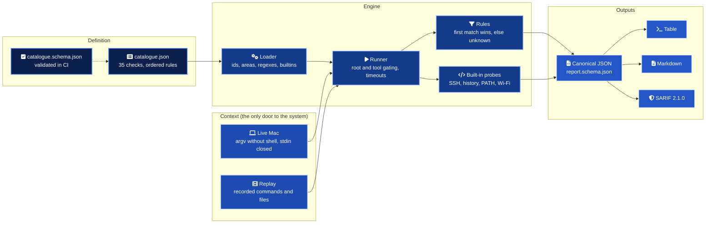
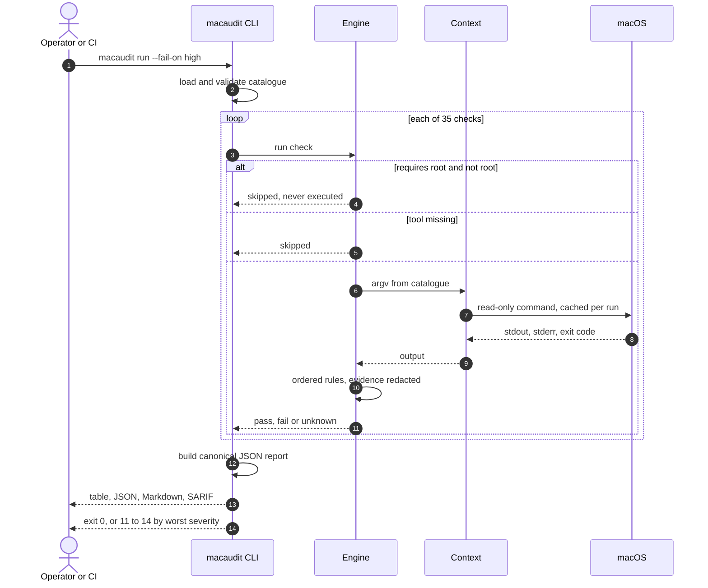
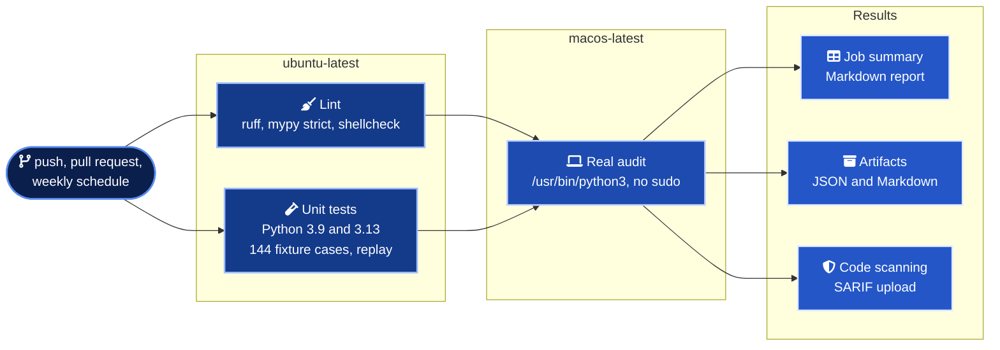

<div align="center">


# macos-security-audit

A read-only security posture audit for macOS that anyone can run, any CI can gate on, and any fleet can ship as JSON.

<p>


</p>

</div>

## In numbers

| Measure | Count | Source |
| --- | ---: | --- |
| Checks | 35 | [`catalogue.json`](macaudit/data/catalogue.json) |
| Areas covered | 12 | encryption, firewall, integrity, updates, login, sharing, wireless, browser, identity, SSH, shell, packages |
| Checks by severity | 2 critical, 10 high, 17 medium, 5 low, 1 info | [check catalogue](docs/checks.md) |
| Checks declared as pure data (no Python) | 29 | the other 6 use small built-in probes |
| Checks that need root | 1 | skipped and reported as skipped without sudo |
| Output formats from one run | 4 | table, JSON with schema, Markdown, SARIF 2.1.0 |
| Distinct exit codes | 7 | `0`, `2`, `3` and `11` to `14` by worst severity |
| Recorded fixture cases | 144 | 50 pass, 49 fail, 37 unknown, 8 skipped |
| Unit tests | 45 | `tests/`, run on Python 3.9 and 3.13 |
| Runtime dependencies | 0 | Python standard library only |
| Actions pinned to a commit SHA | 7 of 7 | [`ci.yml`](.github/workflows/ci.yml) |
| Changes made to the audited machine | 0 | see [ADR 0003](docs/adr/0003-read-only-never-remediate.md) |

## What it is

`macaudit` answers one question about a Mac, quickly and honestly. Is this laptop configured the way a security team would want it? It checks FileVault, the firewall, Gatekeeper, SIP, update settings, screen lock, sharing services, AirDrop, Safari, SSH hygiene, shell history, PATH and Homebrew, then reports in the format the reader needs.

It is built for the places where an MDM is missing or not trusted yet. A developer can run it on their own laptop in two seconds. A CI job can fail a build on a high finding. A small team can schedule it with launchd and collect JSON from every machine. It never asks for root and never changes a setting. Remediation is printed, not applied.

The checks are inspired by the structure of public macOS hardening work such as the CIS-style benchmarks and the macOS Security Compliance Project. Each check is written in this repository's own words and references public NIST SP 800-53 control identifiers.

## Architecture



Every probe goes through a single Context. On a Mac it runs real commands. In tests and demos it answers from a recording. That one seam is why every check can be tested on Linux, and why the tool cannot write. Neither implementation has a write method.

## How an audit runs



## Quick start

macOS ships Python 3.9 at `/usr/bin/python3` with the Command Line Tools. Nothing else is needed.

```bash
git clone https://github.com/marlyngiselle/macos-security-audit.git
cd macos-security-audit
bin/macaudit run
```

The commands you will use most.

```bash
bin/macaudit run --fail-on medium                  # gate on medium and above
bin/macaudit run --area ssh --area sharing         # focus on two areas
bin/macaudit run --json-out out/report.json --markdown-out out/report.md --sarif-out out/report.sarif
bin/macaudit explain MA-SHR-01                     # why it matters and how to fix it
bin/macaudit list                                  # every check, with severity and root needs
sudo bin/macaudit run                              # include the root-only check
```

No Mac at hand? Replay the fictional sample laptop on any OS.

```bash
python3 -m macaudit run --replay examples/replay/sample-host.json
```

## Sample output

> [!NOTE]
> This output comes from the fictional host in [`examples/replay/sample-host.json`](examples/replay/sample-host.json), filtered to three areas. It is not a real machine.

```text
$ bin/macaudit run --replay examples/replay/sample-host.json --area sharing --area ssh --area updates
macaudit 1.0.0  macOS 15.5 (24F74), arm64  2026-10-26T09:00:00Z

STATUS   SEVERITY  ID        AREA    CHECK
PASS     medium    MA-UPD-01 updates Automatic update checks are enabled
PASS     high      MA-UPD-02 updates Security responses and system files install automatically
PASS     high      MA-UPD-03 updates Critical updates install automatically
FAIL     medium    MA-UPD-04 updates macOS updates install automatically
                                     -> macOS updates wait for manual installation.
FAIL     high      MA-SHR-01 sharing Remote Login (SSH server) is off
                                     -> Remote Login is on.
PASS     high      MA-SHR-02 sharing Screen Sharing is off
PASS     medium    MA-SHR-03 sharing File Sharing (SMB server) is off
PASS     low       MA-SHR-04 sharing Printer Sharing is off
SKIPPED  medium    MA-SHR-05 sharing Remote Apple Events are off
PASS     medium    MA-SSH-01 ssh     SSH directory and private keys are private
FAIL     medium    MA-SSH-02 ssh     SSH client configuration keeps host verification
                                     -> SSH client configuration weakens host verification.
FAIL     medium    MA-SSH-03 ssh     SSH private keys are protected by a passphrase
                                     -> 1 private key(s) have no passphrase.

12 checks: 7 pass, 4 fail, 0 unknown, 1 skipped. Score 64%.
Policy: fail on high and above. Exit code 13.
Run 'macaudit explain <ID>' for remediation steps. Nothing was changed on this machine.
```

<details><summary>The same finding in the JSON report</summary>

```json
{
  "id": "MA-SHR-01",
  "title": "Remote Login (SSH server) is off",
  "area": "sharing",
  "severity": "high",
  "status": "fail",
  "reason": "Remote Login is on.",
  "evidence": "\"com.openssh.sshd\" => enabled",
  "requires_root": false,
  "probe": "launchctl print-disabled system",
  "references": ["CIS-style section: Sharing, remote login", "NIST SP 800-53 AC-17", "NIST SP 800-53 CM-7"]
}
```

</details>

## Outputs and exit codes

| Format | How | Built for |
| --- | --- | --- |
| Table | default stdout | A person at a terminal, coloured on a TTY |
| JSON | `--json-out FILE` or `--format json` | Fleet collectors and `jq`, validated by [`report.schema.json`](macaudit/data/report.schema.json) |
| Markdown | `--markdown-out FILE` or `--format markdown` | Job summaries, pull requests, tickets |
| SARIF 2.1.0 | `--sarif-out FILE` or `--format sarif` | GitHub code scanning, with `security-severity` per rule |

| Exit code | Meaning |
| ---: | --- |
| `0` | Nothing failed at or above `--fail-on` (default `high`) |
| `11` / `12` / `13` / `14` | Worst failure is low / medium / high / critical |
| `2` | Usage error |
| `3` | The check catalogue is invalid |

`unknown` and `skipped` never count as a pass and never fail the run. Details in [output formats](docs/output-formats.md).

## What it touches

| Capability | macaudit | Why |
| --- | --- | --- |
| Run commands | Only argv listed in the catalogue, no shell, stdin closed, timeout per probe | Reviewable and injection-free |
| Read files | `~/.ssh`, shell history modes, PATH directories | The few checks a command cannot answer |
| Write files | Only the report paths you pass | Nothing else, ever |
| Use sudo | Never | Root-only checks are skipped unless you start the run as root |
| Collect identity | No hostname, serial or user name. Home paths become `~` | Reports are safe to ship |
| Network | None. `brew outdated` runs with auto-update disabled | Works offline and on air-gapped machines |

## Delivery



Everything is automatic. The macOS job runs with `--fail-on none` because a hosted runner is not a laptop, and its findings are recorded rather than enforced. The SARIF upload is skipped for pull requests from forks, which cannot hold `security-events: write`.

## Before you rely on it

> [!IMPORTANT]
> macaudit observes, it does not enforce. A user with admin rights can change any of these settings a minute after a clean report. Pair it with configuration profiles when you need enforcement, and use macaudit to verify that they landed.

> [!WARNING]
> Settings delivered by a configuration profile, and Safari settings stored in its sandbox container, can read as `unknown`. That is deliberate. The tool never guesses a pass from a missing value.

> [!CAUTION]
> Code scanning alerts from the CI job describe an ephemeral GitHub-hosted runner, where FileVault and similar controls are expected to be off. Read them as proof that the pipeline works, not as findings about anyone's laptop.

## Repository map

```text
.
├── bin/macaudit                     run from a checkout with the system Python
├── macaudit/
│   ├── cli.py                       run, list, explain, render
│   ├── catalogue.py                 load and validate the catalogue
│   ├── context.py                   live and replay contexts, the only door to the system
│   ├── engine.py                    gating, ordered rules, evidence redaction
│   ├── probes.py                    built-in probes for SSH, history, PATH and Wi-Fi
│   ├── report.py                    canonical JSON report and exit codes
│   ├── render.py                    table, Markdown, SARIF, catalogue docs
│   └── data/                        catalogue.json and both JSON schemas
├── tests/
│   ├── fixtures/cases/              144 recorded cases, one file per area
│   ├── schemas/                     official SARIF 2.1.0 schema
│   └── test_*.py                    checks, engine, catalogue, outputs, CLI
├── examples/
│   ├── replay/sample-host.json      fictional laptop for demos and docs
│   └── fleet/                       LaunchAgent and shipping script
├── docs/                            threat model, catalogue, guides, ADRs
└── .github/                         CI workflow, Dependabot, banner
```

## Documentation

| Document | What it answers |
| --- | --- |
| [Check catalogue](docs/checks.md) | Every check by area, its probe and its expected state. Generated from the catalogue |
| [Threat model](docs/threat-model.md) | Which laptop threats each check addresses, and the threats against the tool itself |
| [Output formats](docs/output-formats.md) | Statuses, exit codes, the JSON schema and how SARIF maps to code scanning |
| [Adding a check](docs/adding-a-check.md) | From a probe on your Mac to a tested, documented check |
| [Fleets without an MDM](docs/fleet-without-mdm.md) | Scheduling with launchd or cron and shipping JSON privately |
| [ADR 0001](docs/adr/0001-python-standard-library-only.md) | Why Python with the standard library only |
| [ADR 0002](docs/adr/0002-declarative-json-catalogue.md) | Why checks are data evaluated by ordered rules |
| [ADR 0003](docs/adr/0003-read-only-never-remediate.md) | Why the tool is read-only and never remediates |

## Development

```bash
python3 -m pip install -r requirements-dev.txt
python3 -m unittest discover -s tests -t .
ruff check . && ruff format --check . && mypy
python3 -m macaudit list --format markdown > docs/checks.md
```

<div align="center">
<br>
<sub>Built by Giselle Da Costa. MIT licensed.</sub>
</div>
