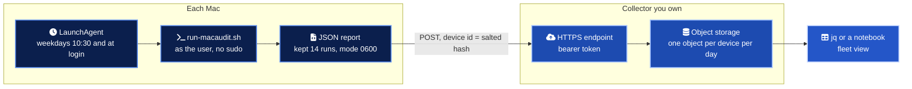

# Running macaudit across a fleet without an MDM

Small teams often have a dozen Macs and no device management. macaudit fits that gap: it needs no agent, no root and no third-party Python packages, and its JSON report is designed to be shipped.

> [!IMPORTANT]
> macaudit observes. It does not enforce. If you need settings that cannot be turned off by the user, you need configuration profiles, which means an MDM.

## How it fits together



## 1. Install the tool on each Mac

```bash
sudo git clone https://github.com/marlyngiselle/macos-security-audit.git /usr/local/share/macaudit
/usr/local/share/macaudit/bin/macaudit run
```

`/usr/bin/python3` ships with the Xcode Command Line Tools. Nothing else is installed.

## 2. Schedule it with launchd

The example agent in [`examples/fleet/com.example.macaudit.plist`](../examples/fleet/com.example.macaudit.plist) runs [`run-macaudit.sh`](../examples/fleet/run-macaudit.sh) every weekday and at login, as the logged-in user.

```bash
cp /usr/local/share/macaudit/examples/fleet/com.example.macaudit.plist ~/Library/LaunchAgents/
launchctl bootstrap "gui/$(id -u)" ~/Library/LaunchAgents/com.example.macaudit.plist
launchctl kickstart -k "gui/$(id -u)/com.example.macaudit"
ls ~/Library/Application\ Support/macaudit/
```

A per-user agent is deliberate. It sees the same Safari, SSH and shell settings the user does, which a root daemon would not. Root-only checks are reported as skipped.

### cron instead of launchd

If you prefer cron, the same script works unchanged.

```bash
( crontab -l 2>/dev/null; echo '30 10 * * 1-5 /bin/bash /usr/local/share/macaudit/examples/fleet/run-macaudit.sh' ) | crontab -
```

launchd is the better choice on macOS: it runs missed jobs after sleep, which cron does not.

## 3. Ship the JSON

Set an HTTPS endpoint and store its token in the login keychain once per Mac.

```bash
security add-generic-password -s macaudit-upload -a "$USER" -w
```

Then add `MACAUDIT_UPLOAD_URL` to the `EnvironmentVariables` of the LaunchAgent. The script posts the report with two headers, `Authorization` and `X-Macaudit-Device`.

| Design choice | Reason |
| --- | --- |
| Device id is `sha256(salt + hardware UUID)`, first 16 hex characters | Stable per device, meaningless outside your fleet, no hostname or serial |
| Token read from the keychain and passed to curl on stdin | Never visible in `ps` or in the plist |
| HTTPS only, enforced by the script and by `--proto '=https'` | Reports describe weaknesses. They must not travel in clear text |
| Reports kept locally even when upload fails | The next successful run does not lose history |
| `--fail-on none` | A scheduled run records findings. It does not page anyone |

The collector can be anything that accepts a POST: a small function behind an API gateway, a presigned bucket URL, or an internal web service. The report format is versioned and described by [`report.schema.json`](../macaudit/data/report.schema.json), so validate it on arrival.

## 4. Read the fleet

With one report per device in a folder, `jq` gives a fleet view without any database.

```bash
# Failed checks across the fleet, most common first
jq -r '.results[] | select(.status == "fail") | "\(.severity)\t\(.id)\t\(.title)"' reports/*.json \
  | sort | uniq -c | sort -rn

# Devices with a high or critical failure
jq -r 'select(.summary.failed_by_severity.high + .summary.failed_by_severity.critical > 0)
       | input_filename' reports/*.json

# Score per report
jq -r '[input_filename, .summary.score] | @tsv' reports/*.json
```

## Limits worth knowing

- Settings delivered by a configuration profile may read as `unknown`. That is honest: the local preference file does not hold them.
- A user with admin rights can unload the LaunchAgent. Missing reports are themselves a signal; alert on silence.
- Safari settings live in a sandbox container. Grant Full Disk Access to the terminal or to `/bin/bash` only if you need those two checks scored.
